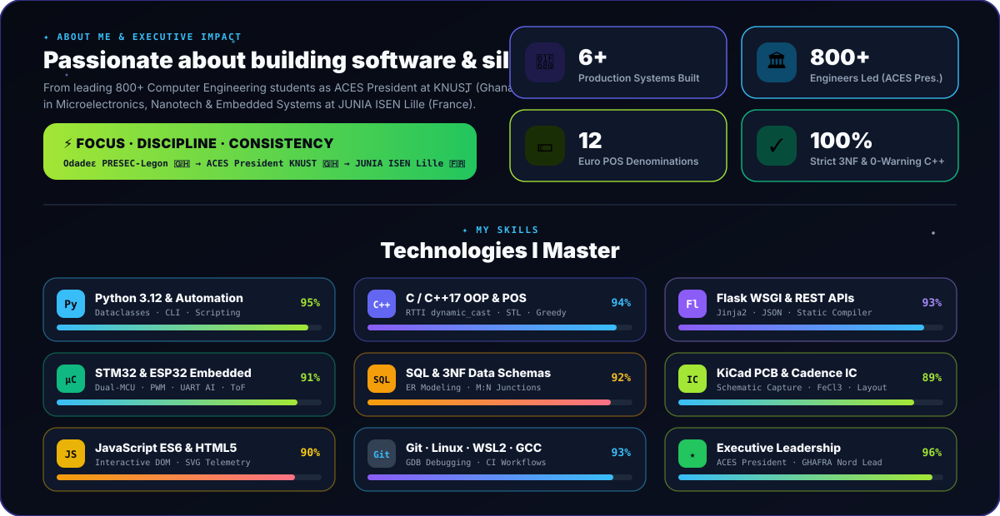

  <!-- =====================================================================
       SECTION 1: CODECRAFT + AARAV + DIKSHANT ILLUSTRATED HERO STAGE
       ===================================================================== -->
  

    

  
  
  
  

 

  <!-- =====================================================================
       SECTION 2: ABOUT ME + 2x2 GLOWING STATS + 3-COLUMN SKILLS MATRIX
       ===================================================================== -->
  

 

  <!-- =====================================================================
       SECTION 3: ALTERNATING JOURNEY TIMELINE + VISUAL PROJECT CARDS
       ===================================================================== -->
  

 

  <!-- =====================================================================
       SECTION 4: 5-STEP ENGINEERING PROCESS & DEDICATED CV DOWNLOAD BANNER
       ===================================================================== -->
  

---

### 🚀 Complete Systems & Repository Directory

| # | System / Repository | Primary Stack & Subject Focus | Architectural Summary |
| :-: | :--- | :--- | :--- |
| **01** | **[`Hanz-Portfolio-webisite`](https://github.com/HanzSintim/Hanz-Portfolio-webisite)** *[▶ Open Interactive Showreel & Sandbox ↗](https://hanzsintim.github.io/Hanz-Portfolio-webisite/)* | **`Python 3.12`** · `Flask WSGI` · `Jinja2` · `REST JSON API` · `ES6` | Full-stack **Python** telemetry & portfolio engine (`data_engine.py`, `app.py`) featuring a 3-in-1 interactive hardware/POS sandbox, 3D mouse-parallax illustrated hero, dual Dark Neon / Frosted Glass themes, downloadable EN/FR CVs, and static GitHub Pages compiler. |
| **02** | **[`LECLERC-Self-Checkout`](https://github.com/HanzSintim/LECLERC-Self-Checkout)** *Caisse Libre-Service POS* | **`C++17`** · `OOP Polymorphism` · `RTTI dynamic_cast` · `STL` | French **E.Leclerc Self-Checkout Terminal** with optical/load-cell bagging scale verification (`Physicalproducts` vs `Digitalproduct`), 12-denomination Euro cash validator + **Greedy Change-Making Algorithm**, French PSD2 NFC (`<= 50€`) / EMV Chip+PIN, and TVA 20% receipt engine. |
| **03** | **Autonomous Street-Cleaning Robot** *JUNIA ISEN Lille M1 R&D* | **`Embedded C`** · `STM32` · `ESP32` · `UART AI Vision` · `ToF` | 7-member M1 R&D architecture partitioning hard real-time **STM32** PWM H-bridge traction & brush control from **ESP32** wireless telemetry, UART AI debris vision, and ultrasonic time-of-flight emergency braking. |
| **04** | **[`CoE_group22`](https://github.com/HanzSintim/CoE_group22)** *Smart Logistics & 3NF Schema* | **`SQL`** · **`Python`** · `3NF Normalization` · `ER Modeling` | End-to-end relational database schema resolving complex `M:N` cardinalities via composite-key associative junction tables and strict **Third Normal Form (3NF)** normalization. |
| **05** | **Automatic Water Tank Controller** *Closed-Loop Embedded Lab* | **`Embedded C/C++`** · `Arduino AVR` · `40kHz Ultrasonic` · `KiCad` | Non-contact acoustic Time-of-Flight liquid level sensing ($d = \frac{v \cdot t}{2}$) with dual-threshold Schmitt hysteresis relay control to eliminate pump chatter and live `16x2 LCD` operator telemetry. |
| **06** | **[`AgriKorn/AgricConnect`](https://github.com/AgriKorn/AgricConnect)** & **[`Data-Table`](https://github.com/HanzSintim/Data-Table)** | **`Python`** · `JavaScript ES6` · `HTML5 / CSS3` · `Data Tables` | Freshness-aware farm-to-market supply chain platform connecting farmers, buyers, and drivers, paired with structured relational web data tables. |
